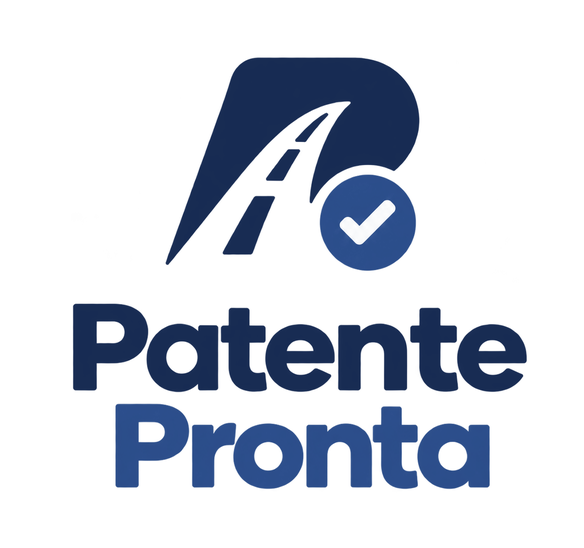

<p align="center">
  
</p>

<p align="center">
  <strong>Study for the Italian driving licence theory exam (patente A/B) at your own level.</strong><br>
  Realistic timed exams, focused practice and a question bank you can tune to what you already know.
</p>

<p align="center">
  <a href="https://github.com/jmorgadov/patente-pronta/actions/workflows/qa.yml"></a>
  
  
  
  
  <a href="LICENSE"></a>
</p>

<p align="center">
  <a href="#features">Features</a> ·
  <a href="#quick-start">Quick start</a> ·
  <a href="#how-it-works">How it works</a> ·
  <a href="#the-question-bank">Question bank</a> ·
  <a href="#contributing">Contributing</a>
</p>

<p align="center">
  
</p>

> [!IMPORTANT]
> **Patente Pronta is not an official practice platform.** It is not affiliated with the
> Ministero delle Infrastrutture e dei Trasporti or the Motorizzazione Civile. It is built on
> the [official list of true/false questions for licences A and B](https://www.ilportaledellautomobilista.it/web/portale-automobilista/-/quiz-per-le-patenti-am-b-superiori-e-cqc) published by
> the ministry under the CC BY 3.0 IT license, but the app and the short chapter names are my own work, and the difficulty levels were
> assigned with AI. Any of them may contain mistakes.

> [!TIP]
> **Always study with a manual as well.** Answering quizzes trains recognition. A good
> theory manual explains *why* each answer is right, and that understanding is what gets you
> through questions phrased in a way you haven't seen before.

## Features

- **Esame**: a simulation of the real test. 30 random questions, never two on the same
  topic, a 20-minute timer, and a pass at 27 correct (at most 3 errors). It moves to the next
  question as soon as you answer and submits itself when time runs out.
- **Esercitazione**: untimed practice on the chapters you choose. Answer and
  get instant feedback, or reveal the answer, then it moves on by itself after a couple of
  seconds.
- **Your own difficulty levels**: every question starts as *Facile*, *Media* or *Difficile*,
  a level assigned with AI for someone almost ready for the exam. You can change a level
  with one tap anywhere: in the list, during practice or when reviewing an exam. Exams and
  practice draw only from the levels you pick, so you can focus on what you still get wrong.
- **Domande**: all 7,020 questions by chapter and quesito, with their figures. A
  "hide answers" switch turns the list into self-test flashcards.
- **Storico**: a progress chart with one line for exams and one for practice, plus every
  completed session with its full review. A practice only counts once you reach the last
  question.
- **Keyboard first**: `V` / `F` to answer, `R` to reveal, `Enter` to move on, `←` `→` to
  navigate.
- Works on a phone, follows your system's light or dark theme, and keeps everything in a
  local SQLite file.

## Quick start

You need [uv](https://docs.astral.sh/uv/) and Python 3.13.

```bash
git clone https://github.com/jmorgadov/patente-pronta.git
cd patente-pronta
cp .env.example .env    # DATA_DIR=./data, DB_PATH=./data/patente.db
make run                # http://localhost:8000
```

On first start the app loads the question bank into `data/patente.db`. Your level changes and
history live only in that file: delete it to start over with the default levels.

Want to look around before studying? `make demo` builds a separate `data/demo.db` with a few
weeks of made-up history and serves it on <http://localhost:8001>. It never touches your own
database.

## How it works

| | Esame | Esercitazione |
|---|---|---|
| Questions | 30, one per topic | as many as you want (default 30) |
| Time | 20 minutes, then it submits itself | none |
| Filters | levels | levels and chapters |
| Feedback | at the end, with a full review | right after each answer |
| Counts in the history | always | only when every question is answered or revealed |
| Passed with | at least 27 correct | — |

A revealed answer in practice counts as done but not correct, so the progress chart reflects
what you actually knew.

Questions are grouped the way the official list groups them: **chapter → quesito**. The 25
chapters are the topics of the ministry's exam programme. A quesito is usually one road sign
or one rule, with several true and false statements about it, and keeps its official number.
The vocabulary used across the code lives in [CONTEXT.md](CONTEXT.md).

## The question bank

Everything the app needs is in [`data/`](data/):

| File | What it is |
|---|---|
| `quiz-AB.pdf` | The official list of true/false questions for licences A and B, from the [Portale dell'Automobilista](https://www.ilportaledellautomobilista.it/web/portale-automobilista/-/quiz-per-le-patenti-am-b-superiori-e-cqc). |
| `quiz.json` | The same questions, extracted and structured: 25 chapters, 715 quesiti, 7,020 questions, each with its starting level. |
| `figures/` | The road signs, intersections and warning lights the questions refer to. |

The questions, answers and figures come from the "Patente AB" list published by the
**Ministero delle Infrastrutture e dei Trasporti** on the
[Portale dell'Automobilista](https://www.ilportaledellautomobilista.it/web/portale-automobilista/-/quiz-per-le-patenti-am-b-superiori-e-cqc), released under
[CC BY 3.0 IT](https://creativecommons.org/licenses/by/3.0/it/) according to the
[ministry's legal notes](https://www.mit.gov.it/note-legali). `quiz.json` and `figures/` are
adapted from that PDF (restructured as JSON, with short chapter names and starting levels
added) and are shared under the same license. See [`data/LICENSE`](data/LICENSE).

The starting levels are **not official data**. They were assigned with AI, reading each
question with a learner in mind who is almost ready for the exam:

- *Facile*: common sense or the basic meaning of a sign; the false statements are absurd.
- *Media*: needs a standard, commonly known rule.
- *Difficile*: hinges on specific numbers, exceptions, one-word traps (*solo*, *sempre*,
  *anche*), rare signs or counter-intuitive rules.

They won't fit everyone, so you can change any of them with one tap, and your changes stay in
your local database. [data/README.md](data/README.md) documents the format and how to
regenerate the JSON from the PDF with `scripts/extract_quiz.py`.

## Project layout

```
src/patente_pronta/
├── main.py        app factory: database, static files, routes
├── web.py         pages and JSON endpoints (FastAPI + Jinja2)
├── store.py       database queries and quiz lifecycle
├── quiz.py        exam and practice rules (drawing, pass mark, timer)
├── bank.py        loads quiz.json into SQLite
├── models.py      SQLModel tables and API schemas
├── settings.py    DATA_DIR / DB_PATH from the environment
├── templates/     server-rendered pages
└── static/        CSS, a little vanilla JS, the logo
scripts/
├── seed_demo.py       builds the demo database
└── extract_quiz.py    rebuilds the question bank from the PDF
```

No frontend build step: pages are rendered on the server, and the timer, auto-advance and
progress chart are a few hundred lines of plain JavaScript.

## Development

```bash
make qa      # ruff lint + format, mypy, pytest with coverage
make test    # tests only
make demo    # demo database on :8001
```

Tests run against a small generated question bank, so they're fast and repeatable.

## Contributing

This is a small project I made for myself while preparing for the exam. If it helps you too,
great! **Every contribution is welcome**: bug reports, corrections to a difficulty level or
a chapter name, UI ideas, translations, or a pull request. Open an
[issue](https://github.com/jmorgadov/patente-pronta/issues) to start a conversation.

## License

- **Code**: [MIT](LICENSE) © Jorge Morgado Vega.
- **Question bank** (everything in [`data/`](data/)): source Ministero delle Infrastrutture e
  dei Trasporti, [Portale dell'Automobilista](https://www.ilportaledellautomobilista.it/web/portale-automobilista/-/quiz-per-le-patenti-am-b-superiori-e-cqc), licensed under
  [CC BY 3.0 IT](https://creativecommons.org/licenses/by/3.0/it/). See [`data/LICENSE`](data/LICENSE) for the attribution and the changes
  made. The questions and figures also appear in [`docs/demo.gif`](docs/demo.gif).

---

<sub>🚀 Project starter provided by [Cookie Pyrate](https://github.com/gvieralopez/cookie-pyrate)</sub>